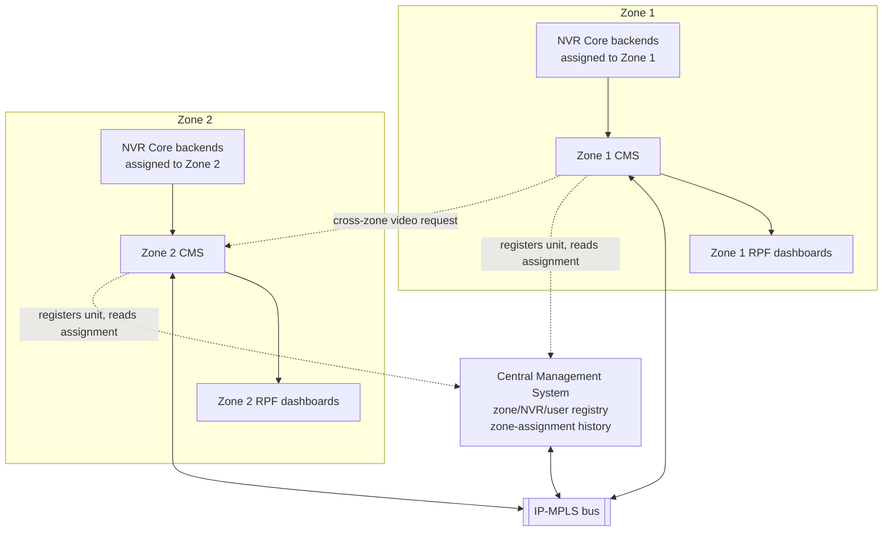
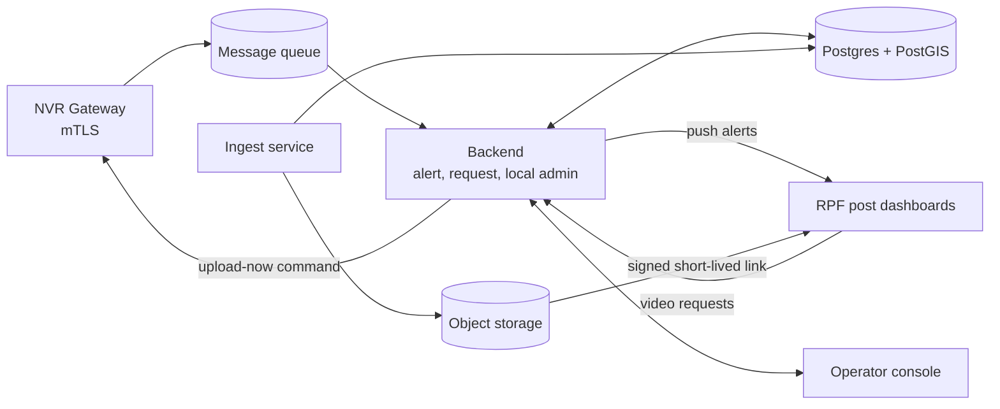

# CMS Architecture (v0.2 draft)

Two-layer system: one **Central Management System (Central)** and N **Zone CMS** instances, one per zone, connected over an IP-MPLS bus. Each Zone CMS receives alerts and video from the NVR units (IPVSS M-NVRs) currently assigned to it, and serves that zone's RPF posts.

## 0. Two-layer topology

- **Central Management System:** registry and coordination only. Holds the zone list, the NVR/camera registry, which zone each NVR unit is currently assigned to (and its assignment history, since a unit's zone changes as it moves), and the user directory (Zone-admins, a super-admin). No alerts or video pass through it.
- **Zone CMS (×N, one per zone):** everything from the earlier design — alert ingestion and routing, video ingest and storage, the operator queue, the request workflow, and the post dashboards. Runs independently per zone; a bus-level outage degrades a zone to working alone, not to working not at all.
- **Backbone:** IP-MPLS bus connecting Central and every Zone CMS. Bus topology, not a chain, so any two zones (or a zone and Central) reach each other in one hop; there is no cascading partition from a single link failure. The bus itself as a shared medium is a network-layer dependency, not something the CMS software can fix.
- **Access model:** strictly siloed per zone. A Zone-admin sees and manages only their own zone (users, posts, NVR units, cameras within it). A super-admin at Central has visibility and control across all zones. This is v1; cross-zone read access for admins can be added later without changing the data model.

## 1. Scope

- Central: maintain the zone/NVR/camera registry and current zone assignment; record assignment history as units move between zones; manage the user directory and roles (Zone-admin, super-admin).
- Each Zone CMS: receive alerts from NVR units currently assigned to it. High-priority alerts go straight to the responsible RPF post; low-priority alerts go to a CMS operator first.
- Each Zone CMS: receive and store video uploaded by its assigned NVR units, including resumable uploads after connection loss.
- Let RPF posts request video. An operator approves each request before the post gets access. If the requested window spans a period when the unit belonged to a different zone, the request is resolved against Central's assignment history and forwarded to the zone(s) that held the footage, then the results are merged.
- Out of scope for v1: alert priority tuning, analytics, NVR-side software, camera (ONVIF) integration (owned by IPVSS/the NVR vendor); cross-zone admin visibility; handling alerts near a zone boundary where the geographically nearest post sits in a neighbouring zone while the unit is still assigned to the old one (known v1 gap, see section 11).

## 2. Assumptions and sizing

Numbers given: 300-400 NVR units at full scale, 8-16 cameras per unit, 10 alerts per unit per day, 30-day video retention. Start smaller and scale up.

| Item | Pilot (assumed 50 units) | Full scale (400 units) |
| --- | --- | --- |
| Cameras | up to 800 | up to 6,400 |
| Alerts per day | 500 | 4,000 |
| GPS points per day (1 Hz, assumed) | \~4.3 M | \~34.5 M |
| Video generated per day (assumed 2 Mbps per camera, 24 h) | \~17 TB | \~138 TB |
| Video stored at 30 days | \~0.5 PB | \~4 PB |
| Sustained inbound rate if all video is uploaded | \~1.6 Gbps | \~12.8 Gbps |

Reading the table:

- Alerts and metadata are small. One Postgres instance handles them.
- Video dominates everything: storage, network, cost. The video rows above rest on the bitrate, recording hours and upload policy assumptions, which are unconfirmed (see section 10).
- GPS points at 1 Hz is the largest table by row count, so it is partitioned by time from day one.

## 3. System context

Within one Zone CMS, the internal shape is as before:

## 4. Components

### 4.1 Central Management System (one instance, whole network)

| Component | Responsibility |
| --- | --- |
| Registry service | Zones, NVR units, cameras, RPF posts (which zone each belongs to). |
| Assignment service | Tracks which zone each NVR unit is currently assigned to; appends a history row whenever a unit's zone changes. Answers "which zone(s) owned unit X during window \[t1, t2\]?" for cross-zone requests. |
| User directory | Zone-admin accounts (scoped to one zone) and the super-admin account (scoped to all zones). Authentication for all dashboards ultimately checks against this. |
| Central API | The only thing a Zone CMS talks to on Central: register/update a unit's current zone, look up assignment history, resolve a user's role and zone scope. |

### 4.2 Zone CMS (one instance per zone, same software)

| Component | Responsibility |
| --- | --- |
| NVR Gateway | Terminates mTLS, authenticates each assigned NVR unit by certificate, accepts alerts and metadata, pushes commands (for example "upload this time range now"). |
| Message queue | Durable buffer between gateway and backend, with retries and a dead-letter queue. |
| Alert module | Stores alerts, routes by priority threshold, runs the acknowledgement timer and escalation, all within this zone. |
| Request module | Video requests from this zone's posts; if a request's time window may fall outside this zone's own custody, it asks Central's assignment service and forwards part of the request to the other zone's CMS over the bus, then merges results. |
| Local admin module | This zone's posts, users (Zone-admin managed), NVR and camera details, synced against Central's registry. |
| Ingest service | Receives chunked uploads, verifies hashes, writes to this zone's object storage, updates this zone's video catalogue. Scaled separately from the backend because its load is very different. |
| Postgres + PostGIS | This zone's alerts, video catalogue, requests, and a cached copy of the registry entries relevant to it. PostGIS supports the nearest-post lookup. |
| Object storage | S3-compatible, holds this zone's video segments. |
| Post dashboard | Web app, this zone's posts only. Alerts in, acknowledgements, video requests, playback of approved footage. |
| Operator console | Web app, this zone's operators only. Low-priority alert queue, request approvals, NVR health, upload status. |

Deployment style for v1: one modular backend plus the ingest service per zone, not many microservices; Central as a small separate service, since its load and lifecycle are unrelated to any zone's.

## 5. Key flows

### 5.1 High-priority alert

1. NVR writes the alert to its local outbox with event time, GPS position at event, camera, type, priority.
2. NVR sends it to the gateway. If the link is down, it retries later with the original event time and position.
3. Gateway puts it on the queue. Backend stores it, deduplicating on (NVR id, NVR event id).
4. Priority at or above threshold: routing picks the post using the event position and pushes it to that post's dashboard.
5. Post acknowledges. If no acknowledgement within the timeout, the alert escalates to a secondary post or the control room.

### 5.2 Low-priority alert

Same steps 1-3, then the alert lands in the operator queue. The operator assigns a post or dismisses it. An aging timer escalates alerts nobody has looked at.

### 5.3 Video upload

1. NVR uploads segments when 5G is available, in chunks, resuming from the last confirmed chunk after a drop.
2. Ingest verifies each chunk hash, assembles the segment, writes to object storage, records the segment in the catalogue with its time range and first/last GPS point.
3. Segments not yet uploaded show as "pending" in the catalogue.

### 5.4 Video request

1. Post submits a request: alert reference (optional), camera, time window, reason.
2. Operator reviews. Approve, reject, or amend the time window.
3. If the footage is not uploaded yet, CMS sends an upload-now command to the NVR and the request waits.
4. On approval and availability, CMS issues a short-lived, single-user signed link. Post plays it from object storage.
5. Every step is written to the audit log.
6. If the window may span a zone change (see 5.5), step 3 first resolves custody via Central, then proceeds per zone as in 5.6.

### 5.5 Zone handover (a NVR unit moves between zones)

1. A NVR unit starts sending alerts and video to a different Zone CMS (its 5G/IP-MPLS link now reaches that zone).
2. The new Zone CMS calls Central: "unit X is mine as of time T."
3. Central appends a row to the unit's assignment history. The old zone is not notified; it simply stops receiving from that unit.
4. From time T onward, all new alerts and video from unit X are the new zone's, stored and routed locally there.

### 5.6 Cross-zone video request

1. A post's requested time window may not be fully covered by its own zone's custody of the unit.
2. The request module asks Central's assignment service which zone(s) owned the unit during that window.
3. If more than one zone is involved, the request module forwards the relevant sub-window to each other zone's CMS over the bus.
4. Each zone returns its own segment of footage (or a pending/upload-now status); the originating zone merges results and presents one response to the post.
5. Access is still granted only through the requesting zone; a post never talks to another zone's CMS directly.

## 6. Routing rule (as currently specified)

- Priority at or above the threshold: automatic to the nearest post by GPS distance at the event position.
- Priority below the threshold: operator decides.
- NVR priority is taken as given (one vendor owns the NVR and its priority logic).
- Design note: the routing logic sits behind one function, so jurisdiction polygons or route-based lookup can replace pure distance later without touching the rest.

## 7. Network and security

- NVR to CMS and CMS to RPF traffic runs over the IP-MPLS network.
- mTLS on top of MPLS, with per-NVR certificates and revocation. MPLS isolates traffic but does not encrypt it.
- Two traffic classes: alerts and commands (high priority), bulk video upload (low priority), so an upload backlog never delays an alert.
- Role-based access scoped per post: a post sees only its own alerts and approved footage.
- Zone-admins are strictly siloed to their own zone (users, posts, NVR units, cameras within it). No cross-zone visibility in v1.
- One super-admin role at Central has visibility and control across all zones and manages Zone-admin accounts. All authentication resolves against Central's user directory regardless of which zone's dashboard is being used.
- Video access only through signed, expiring links. Tokens stored hashed.
- Append-only audit log with UPDATE and DELETE revoked at the database level.
- Clocks on NVR units synced (GPS time or NTP). Video and alerts cannot be matched without it.

## 8. Data design (summary)

Correction from the original two-database plan above: the system runs as **one central database**, not a separate Central DB plus one per zone. Every zone-scoped table carries a `zone_id` column instead, with row-level isolation enforced at the application layer (and available as Postgres Row-Level Security once a non-owner application role exists — see the open item below).

**Registry**

- `zone` (id, name)
- `nvr_unit` (id, name, cert fingerprint, current_zone_id)
- `nvr_zone_assignment` (nvr_id, zone_id, assigned_from, assigned_until nullable) — the history used to resolve cross-zone requests; `assigned_until` is null for the current assignment
- `rpf_post` (id, name, zone_id, location point)
- `users` (id, zone_id nullable — null for super-admin, post_id — set only for a post-scoped user, role, status)
- `camera` (id, nvr_id, name, mount position, onvif reference)

**Alerts**

- `alert` (id, nvr_id, nvr_event_id, zone_id, alert_type, priority, event_time, location, status, routing_mode, assigned_post_id) — partitioned by month on `event_time`
- `alert_delivery` (alert, post, sent/ack times, escalation link)
- `alert_history` (status changes over time)

**Video**

- `video_segment` (nvr_id, camera_id, zone_id, time range, storage pointer, hash, upload status) — the video catalogue
- `upload_session` (resumable upload progress per segment)
- `gps_point` (nvr_id, time, location) — partitioned by month, the highest-row-count table

**Requests and evidence**

- `video_request` (post, requester, camera, time window, status, operator decision)
- `video_access_grant` (short-lived signed token per approved request)
- `incident` — raised by a person against one specific `alert_delivery` (not the alert directly, so the post is guaranteed consistent with the delivery); carries a write-once snapshot of alert type, location and time so the record survives even if the source alert row is later archived
- `delivered_footage` — one row per footage file actually handed to a post; insert-only (enforced by a trigger, since privileges can't be revoked from a table's owner), so it stands as a real record of what was delivered
- `evidence_flag` — marks delivered footage that must be retained beyond normal policy, with a justification and a retention window

**Audit**

- `audit_log` — append-only

Principles:

- Two timestamps on every alert: `event_time` and `received_time`, all UTC.
- Unique (`nvr_id`, `nvr_event_id`) makes NVR retries safe.
- Video links to alerts by camera and time window, not by foreign key, since an alert can arrive before its video.
- `gps_point` and `alert` are partitioned by month; partitions must be created ahead of need.
- Video retention job deletes segments older than 30 days unless they're covered by an active `evidence_flag`.
- Open item: the application currently connects as the same role that owns the schema (`cms`), which means Row-Level Security policies would be bypassed even if enabled, and the append-only protections on `audit_log`/`delivered_footage` rely on triggers rather than revoked privileges for the same reason. A separate, non-owner application role is the standard fix, not yet done.

## 9. Delivery phases

1. **Pilot:** about 20-50 NVR units. Alert routing, ingest, request workflow, basic dashboards.
2. **Scale test:** simulate 400 units of alerts and uploads before adding real units.
3. **Full rollout:** scale storage and ingest nodes to measured, not estimated, load.

## 10. Open questions

1. Where the data centre(s) are — is Central and each Zone CMS in the same physical data centre, or genuinely distributed by zone?
2. How many zones for the pilot, and how many RPF posts per zone?
3. Alert and video-access legal requirements (evidence handling, retention holds).
4. Team size split — is the same 2-3 person team building Central as well, or is it a small addition to the Zone CMS scope?
5. How a Zone CMS decides it has "gained" a unit (5G/IP-MPLS reachability signal, or an explicit registration message from the unit itself)?

## 11. Main risks

| Risk | Why it matters |
| --- | --- |
| Video storage and upload volume | Can be off by an order of magnitude depending on assumptions in section 2. |
| Nearest-by-GPS routing | Straight-line distance may pick a post that is not the responsible one on rail. |
| Operator bottleneck | Operators gate low-priority alerts and every video request. |
| Alert arrives before its video | Needs the pending-upload state and the upload-now command. |
| Zone-boundary gap (v1, accepted) | A unit's geographically nearest post may sit in a neighbouring zone while it is still assigned to the old one; that post won't get the alert until handover completes. |
| Central as a dependency | Every zone handover and every cross-zone request needs Central to be reachable over the bus. Each zone still runs alerts/video locally if Central is briefly unreachable, but handovers and cross-zone lookups stall until it's back. |
| Shared bus as single medium | Bus topology avoids line-topology cascading partition, but the bus itself going down still stops all inter-zone and Central traffic; each zone keeps working alone. |